  <picture>
    <source media="(prefers-color-scheme: dark)" srcset="./assets/header-dark.svg">
    
  </picture>

<h3 align="left">Perfil</h3>

  Desarrollador web con conocimientos en HTML, CSS, JavaScript y React, y construyo la lógica del servidor y la gestión de bases de datos con PHP y SQL. Empleo Python en análisis de datos, automatización de procesos y aprendizaje automático, y Java en programación orientada a objetos. Cuento con formación en servicios de nube e inteligencia artificial de AWS, e incorporo herramientas de IA generativa al ciclo de desarrollo para optimizar procesos y reducir los tiempos de entrega. Utilizo Git y GitHub para el control de versiones y la colaboración ordenada en equipo, y mantengo una actualización técnica constante como parte de mi crecimiento profesional.

<h3 align="left">Contacto</h3>

  
  

<h3 align="left"><u>Habilidades</u></h3>

  <b>Lenguajes:</b> 
  
  

  <b>Desarrollo Web:</b> 
  
  
  
  
  
  

  <b>Nube e IA Generativa:</b> 
  
  

  <b>Modelado y Renderizado 3D:</b> 
  
  

  <b>Herramientas:</b> 
  
  
  
  
  

